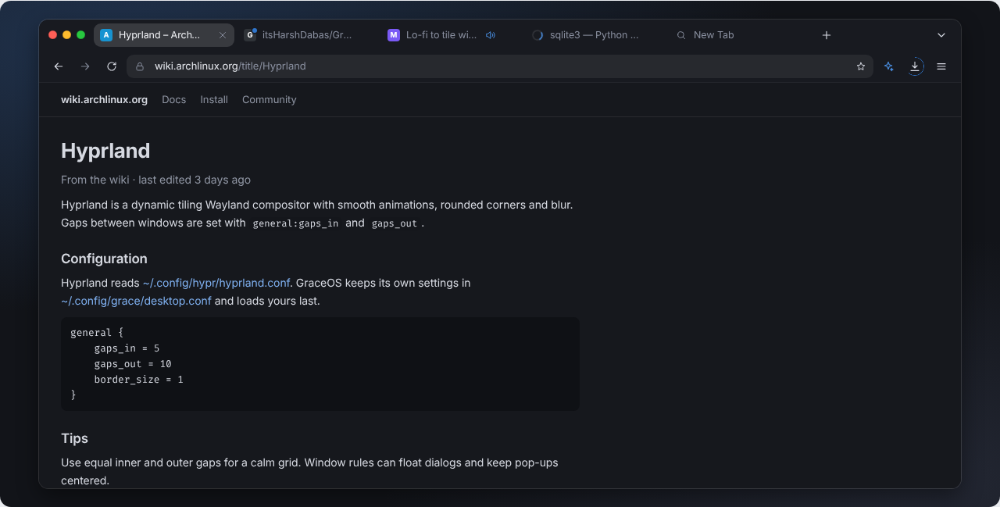

# CottonCandy: UI design

_Status: proposal, 2026-10-20, for review by Harsh and the Shell lead._

_Interactive mockup: [mockups/cottoncandy-ui.html](mockups/cottoncandy-ui.html). Open it in any browser. It works offline; without Google Fonts it uses Inter and Fira Code if they're installed. The controls at the top switch theme, accent, corners, gap, blur, motion, AI, the header layout and tiled or floating, live. Screenshots: [screenshots/](screenshots/)._

_Contrast numbers: run `python3 docs/design/contrast.py` (it exits 1 if any pair fails AA)._

CottonCandy must look like it was made by the team behind Grace Candyland and CandySole. It follows `docs/design/2026-10-19-grace-shell-design.md` in the GraceOS repo, and it uses the real tokens from grace-candyland `shell/config/Theme.qml`.

**The engine is chosen:** Qt 6 + QtWebEngine (GraceOS ADR 0007). The spec stays toolkit-neutral, as the brief asked: tokens, sizes and states. §9 maps it onto Qt.

## 1. Departures from the brief

These are my calls, each backed by `contrast.py` or by the mockup. Each is easy to reverse.

| # | Brief said | This design does | Why |
|---|---|---|---|
| 1 | Placeholders in `textTertiary` | Placeholders in **`textSecondary`**. `textTertiary` is used only for disabled text. | `#7d8392` on the address field is **3.84:1** in dark (needs 4.5). In light it's 4.42. `textSecondary` gives 4.56 (dark) and 5.00 (light). Grace Shell's placeholders likely need the same fix. |
| 2 | Focus border in accent `base` | Focus ring in the **accent text color** (`fg` in dark, `fg-light` in light) | `base` on the field is below 3:1 for purple in dark (2.46). In light, 7 of 9 accents are below 3:1 (blue 2.86). `fg` and `fg-light` are ≥ 3.57 everywhere. |
| 3 | Primary hover: fill lightened ~12% | Primary hover: **fill + 10% black**; pressed: + 18% black | Lightening drops white labels to about 3.7:1 on 8 of 9 accents. Darkening raises them to about 5.5:1. |
| 4 | Accent `fg` from Theme.qml | Pink `fg` `#d86a9f` → **`#d96ba0`**, purple `#b27ac5` → **`#b37bc6`** | 4.49 → 4.55 on the address field. The change is one step and invisible to the eye. Worth porting to Theme.qml. |
| 5 | Light theme: "use `fill` or a darker step" | A computed **`fg-light`** per accent | `fill` as text on light chrome is about 3.5:1. `fg-light` is the fill, darkened until it reaches 4.5:1 on the darkest light surface. |
| 6 | Traffic lights on inactive windows (not specified) | Inactive windows: all three dots in `controlHover` gray | It shows focus the macOS way, without color. |
| 7 | Compact single-row header "as an option" | Compact needs a window **≥ 1000 px** wide; narrower windows fall back to two rows | Measured in the mockup: below that, the active tab gets clipped. |
| 8 | Permission prompt: Allow once / Deny / Details | Same. **Enter and Esc mean Deny**, and answers last for the tab by default. | The v0 code already does Enter = Block. "Never auto-allow" includes the keyboard. |

## 2. Token sheet

### 2.1 Color
Dark is from Theme.qml (the colors that ship today). Light is proposed. Every text pair below was checked with the overlay composited onto the surface it sits on.

| Token | Dark | Light (proposed) | Use in the browser |
|---|---|---|---|
| `desktop` | `#121419` | `#f3f4f6` | New tab page, error pages |
| `window` | `#1c1e25` | `#ffffff` | Content frame, popover bodies |
| `titlebar` | `#181a20` | `#ebecef` | Tab strip, toolbar, find bar |
| `sidebar` | `#17191f` | `#f0f1f4` | Vertical tabs, Grace panel, settings sidebar |
| `panel` (blur on / off) | `rgba(22,24,31,.82)` / `#17191f` | `rgba(250,250,251,.86)` / `#fafafb` | Menus, popovers, address dropdown |
| `hair` | `rgba(255,255,255,.08)` | `rgba(0,0,0,.08)` | Every 1 px edge |
| `subtle` | `rgba(255,255,255,.05)` | `rgba(0,0,0,.06)` | Divider under the chrome |
| `card` | `rgba(255,255,255,.045)` | `rgba(0,0,0,.035)` | Cards, shortcut hover |
| `control` | `rgba(255,255,255,.065)` | `rgba(0,0,0,.05)` | Address bar and field fill |
| `controlStrong` | `rgba(255,255,255,.09)` | `rgba(0,0,0,.07)` | Neutral pills, field hover |
| `controlHover` | `rgba(255,255,255,.12)` | `rgba(0,0,0,.08)` | Hover on any control or tab |
| `selected` | `rgba(255,255,255,.14)` | `rgba(0,0,0,.10)` | Active tab, selected rows, pressed |
| `track` | `rgba(255,255,255,.12)` | `rgba(0,0,0,.10)` | Progress tracks |
| `textStrong` | `#f1f2f6` | `#14161a` | Active tab title, page titles |
| `text` | `#e6e8ee` | `#1d1f24` | Body, URL host |
| `textControl` | `#d9dce5` | `#2b2f37` | Button labels, toolbar icons |
| `textSecondary` | `#8a90a0` | `#575d6a` | Inactive tabs, URL path, placeholders, group labels |
| `textTertiary` | `#7d8392` | `#868b97` | Disabled only (exempt from WCAG) |
| `success` | `#7ed99c` | `#1a7f37` | Local AI dot, "done" |
| `error` | `#ff8a8a` | `#c01c28` | Not secure, certificate and download errors |
| traffic lights | `#ff5f57` `#febc2e` `#28c840` | same | Close, minimize, maximize |

**Window edge** (drawn by the compositor, the same in both themes): 1 px `rgba(255,255,255,.14)` when active and `rgba(255,255,255,.07)` when inactive. Shadow is 0 10 28 at `rgba(0,0,0,.44)` (light: `.18`).

**Popover shadow:** 0 14 34 at `rgba(0,0,0,.45)` (light: `.16`), with blur `2 × blur` and saturate 140%.

### 2.2 Accent
Each swatch has these tokens:
- `base`: the picker identity.
- `fill`: takes a white label.
- `fg`: text, icons and focus ring on dark.
- `fg-light`: text, icons and focus ring on light.
- `tint`: the glow behind the new tab page. In light it's computed as `base` at 14% over `#f3f4f6`.

| Accent | base | fill | fg | fg-light | tint |
|---|---|---|---|---|---|
| blue (default) | `#3584e4` | `#2f75cb` | `#4b92e7` | `#2663a9` | `#20324d` |
| teal | `#2190a4` | `#1d8092` | `#399cae` | `#186c78` | `#1c3540` |
| green | `#3a944a` | `#348442` | `#50a05e` | `#2c713a` | `#21362e` |
| yellow | `#c88800` | `#9c6a00` | `#c88800` | `#845a00` | `#3e331f` |
| orange | `#ed5b00` | `#c74c00` | `#ee650f` | `#a94300` | `#452a1f` |
| red | `#e62d42` | `#dd2b3f` | `#ec6271` | `#bd2337` | `#44212c` |
| pink | `#d56199` | `#b55282` | `#d96ba0` ¹ | `#9b4670` | `#402b3e` |
| purple | `#9141ac` | `#9141ac` | `#b37bc6` ¹ | `#8e40a9` | `#332542` |
| slate | `#6f8396` | `#657788` | `#8092a3` | `#536572` | `#2c323d` |

¹ Lifted one step from Theme.qml (§1, item 4).

**The accent appears only on:**
- The primary pill, switches when on, the selected segment indicator in Settings, and progress fills.
- Focus rings and sparkle icons.
- The tab loading spinner, the audio icon and the recording dot.
- The attention dot, the bookmarked star, the selected accent swatch, and the new tab page glow.

**Never on:** tabs, toolbars, panels, outlines, or large areas.

### 2.3 Contrast results (all pass)
These are the worst cases across all nine accents, from `contrast.py`.

| Pair | Dark | Light | Needs |
|---|---|---|---|
| Active tab title on `selected` | 10.17 | 12.25 | 4.5 |
| Inactive tab title (`textSecondary`) on `titlebar` | 5.45 | 5.59 | 4.5 |
| URL path and placeholder (`textSecondary`) on the field | 4.56 | 5.00 | 4.5 |
| Button label on `controlStrong` | 9.77 | 9.72 | 4.5 |
| Menu secondary text on `panel` | 5.50 | 6.33 | 4.5 |
| New tab page labels on `desktop` | 5.77 | 6.00 | 4.5 |
| `error` text on `window` | 7.33 | 6.11 | 4.5 |
| Lock icon (`success`) on the field | 8.52 | 3.85 | 3 (icon) |
| White on accent `fill` | ≥ 4.61 | ≥ 4.61 | 4.5 |
| White on `fill` hover (+10% black) | ≥ 5.48 | ≥ 5.48 | 4.5 |
| Accent text (`fg` / `fg-light`) on the field | ≥ 4.51 | ≥ 4.51 | 4.5 |
| Accent icon or ring on a `selected` row | ≥ 3.57 | ≥ 4.51 | 3 |

### 2.4 Shape, type, spacing, motion
- **Radius:**
  - sm 7 (menu rows' inner chips), md 9 (tabs, fields, rows), lg 12 (cards, boxes), xl 14 (popovers, the new tab page field).
  - Window corners come from the shell (`--radius`, default 12, range 0–22). Panels use window radius + 8.
- **Gap:** default 10, range 0–24.
  - The chrome's side padding is `max(6, gap)`, so its edges line up with the desktop grid.
  - Tiled windows sit `gap` apart, like every Grace window.
- **Type:**
  - Inter throughout: body 13; tab titles 12.5; group labels 11 at weight 500; buttons 12 at weight 500; page titles 20 at weight 650.
  - Fira Code for URLs in developer contexts, code, error codes, view-source and DevTools.
  - Tabular numbers for counters, sizes and zoom.
- **Sizes:**

  | Element | Size |
  |---|---|
  | Tab strip row | 40 |
  | Toolbar row | 40 (compact single row: 44) |
  | Tab | 30 tall, 112–200 wide (36 when pinned or icon-only) |
  | Icon buttons | 30 round (24 inside fields and rows) |
  | Text field and address bar | 30 |
  | New tab page field | 44 |
  | Pills | 24 (30 for large on error pages) |
  | List rows | 34 (dense 32) |
  | Settings rows | ≥ 50 |
  | Vertical tab rail | 224 wide |
  | Grace panel | 320 wide |
  | Popovers | menu 290, downloads 370, permission 340 |

- **Icons:**
  - One line set on a 24 px grid: 1.7 px stroke, round caps and joins.
  - Shown at 16 in toolbars and 14 in rows.
  - Shapes come from grace-candyland `shell/widgets/icons.js`, plus browser glyphs: back, forward, reload, star, lock, warning, eye-off, mic, camera, speaker, mute, tabs, columns, puzzle, cloud.
  - No emojis.
  - Sites show their real favicons, at 16 in tabs and rows and 32 on the new tab page, with no tile behind them.
- **Motion:**
  - Base durations: fast 150, normal 240, slow 380, multiplied by the preset: Off 0, Calm 1.45, Smooth 1, Snappy 0.65.
  - Curves: in `cubic-bezier(.2,.9,.25,1)`, out `cubic-bezier(.4,0,.6,1)`.
  - Reduce motion (the system setting) forces Off. Then the spinner and the recording pulse become static, and panels appear without sliding.

## 3. Components

### 3.1 Window chrome
- **Two-row header (default):**
  - Row 1 (40): traffic lights, tabs, a "+" button, a flexible space, the Private label if any, and a "⌄" button for the tab list.
  - Row 2 (40): back, forward, reload or stop, the address bar (flexible), the sparkle (AI on only), Downloads and the menu.
  - The chrome background is `titlebar`, with a `subtle` 1 px line between chrome and content. No gradients.
- **Compact header (≥ 1000 px):** traffic lights, navigation, the address bar (38%, at least 200), then tabs with inactive ones as icons only, a flexible space and the actions.
- **Vertical tabs:** a one-row header (traffic lights, sidebar toggle, navigation, address, actions), plus a 224-wide rail in `sidebar`. The rail holds New tab, then pinned tabs as 36 px squares, then 32-tall tab rows.
- **Traffic lights:**
  - 11 px circles, 7 apart, with a 0.5 px `rgba(0,0,0,.28)` edge.
  - Glyphs (`rgba(0,0,0,.55)`, 9 px) appear only while the group is hovered or focused.
  - Order: close, minimize, maximize. Inactive windows show them in `controlHover`.
  - The empty space in row 1 drags the window, and a double-click maximizes.
- **Tiled and floating:** the window's own corners follow `--radius`. In a tile the chrome has no outer margin; the gap comes from Hyprland. Floating windows add the compositor shadow.

### 3.2 Tab
| State | Look |
|---|---|
| Inactive | Transparent, title in `textSecondary`, close button hidden |
| Hover | `controlHover` fill, title in `text`, close button visible |
| Active | `selected` fill, title in `textStrong`, close button visible |
| Focus (keyboard) | 2 px ring in accent text color |
| Loading | A 16 px spinner (1.7 stroke, accent text color, on `track`) replaces the favicon |
| Playing audio | Speaker icon in accent text color, before the close button; clicking it mutes |
| Muted | Mute icon in `textSecondary` |
| Recording (mic or camera in use) | 8 px dot in accent `fill`, pulsing at 1.4 s (static with reduce motion) |
| Pinned | 36 × 30, favicon only; no close button |
| Crashed | Alert icon in `error` replaces the favicon; title "Page crashed" in `textSecondary` |
| Needs attention | 6 px dot in accent `fill` on the favicon's top-right, ringed in `titlebar` |
| Dragging | `selected` fill, popover shadow, raised 1 px and scaled 1.02; the other tabs slide to make room |
| Overflow | Over 7 tabs (or in compact mode), inactive tabs shrink to 36 px icons and the active one keeps its title. Past that, the strip scrolls; the "⌄" list shows every tab. |

### 3.3 Toolbar and address bar
- **Icon buttons:** 30 round, with `textControl` icons. States: hover `controlHover`, pressed or open `selected`, disabled `textTertiary` with no fill, focus ring. The AI sparkle uses the accent text color.
- **Downloads button:** while a download runs, a 1 px ring in accent `fill` shows its progress around the icon.
- **Address bar (rest):** a 30 px field in `control`, radius 9, with a site icon in a 26 × 24 hit area.
  - Lock for https; warning in `error`, plus a "Not secure" label, for http to non-local hosts; a file icon for `file:`; a search icon for empty and internal pages.
  - Then the host in `text` and the rest of the URL in `textSecondary`. The `https://` scheme is hidden.
  - A star button sits at the end. It's filled with the accent text color when the page is bookmarked.
- **Address bar (hover):** `controlStrong`.
- **Address bar (focus):** a 1 px border in accent text color. The whole URL is shown and selected on click, Tab or Ctrl+L; typing replaces it.
- **Dropdown:**
  - A `panel` surface with blur, radius 14, a hairline edge and the popover shadow, aligned to the field's edges and 6 px below it.
  - Groups (11 px labels): Open tabs, Bookmarks, History, Search.
  - Rows are 34 tall: favicon, title, then the host in `textSecondary`. The matched text is weight 600, not colored.
  - The keyboard-selected row is `selected`; hover is `controlHover`.
  - With AI on and some text typed, the Search group ends with "Ask Grace about '…' · Local AI · on this device", with the sparkle icon.
  - Nothing is sent while typing. Suggestions come only from local history, bookmarks and open tabs.
- **Page-load progress:** a 2 px line in accent `fill` on `track`, along the bottom edge of the chrome.

### 3.4 Popovers
- **Site info**, from the site icon: the host; the connection state, written as a sentence; the per-site permissions (Camera, Microphone, Notifications: Ask, Allowed or Blocked); and "Clear cookies and site data…".
- **Permission request:** anchored to the site icon and styled like the Grace approval card. (As built: "Your answer lasts for this tab. Other tabs ask again.", see §7.)
  - A 30 px icon badge.
  - "**meet.example.org wants to use your microphone**", then the secondary line "Only for this tab. It stays off until you choose."
  - Buttons: primary **Allow once**, neutral **Deny**, ghost **Details**. Details expands inline to show the device, the requesting origin and how long the answer lasts.
  - Enter and Esc deny. The card stays until it's answered, and switching tabs keeps it on its own tab.
- **Main menu** (290, rows 32):
  - New tab, New window, New private window.
  - A Zoom row: − 100% + and full screen.
  - History, Bookmarks, Downloads, Find in page.
  - Grace (AI on only), Developer tools, Settings.
  - Quit.
  - Shortcuts are shown as `kbd` chips.
- **Downloads** (370):
  - A header with "Open folder".
  - Rows: a file icon tile, the name, a 4 px bar (accent `fill`, or `textTertiary` when paused), and a status line.
    - Running: "2.9 GB of 4.7 GB · 18 MB/s · 1 min left".
    - "Done · 1.2 GB".
    - "Failed: …" in `error`.
  - Actions: pause or cancel while running, show in folder when done, retry when failed. There is **never an "Open" action** for downloaded files.

### 3.5 Find bar
- Slides down under the toolbar (42 tall, `titlebar`).
- A 280-wide field with a magnifier, then the count ("2 of 14", tabular numbers; "No matches" in `error`), previous and next, a "Match case" toggle pill, and a close button.
- Matches on the page: yellow, with the current one in orange. These are page-content colors, not the accent.

### 3.6 Bookmarks bar
Optional and hidden by default. A 30 px row of 24 px chips (favicon and label, 12 px, `textControl`, `controlHover` on hover).

### 3.7 New tab page
- Background: `desktop` with a radial glow in `tint` (60% × 55% at 50% 28%).
- A 44 px field, radius 14, with a `hair` edge. The leading icon is the sparkle in accent text color (AI on) or a magnifier.
- **Placeholder:** "Search, enter address or ask Grace" (AI on), or "Search or enter address".
- **Hint line:** "Ask Grace about… a page, an error, a doc. Press Tab to ask instead of search." With AI off: "Search with DuckDuckGo or type an address."
- **Shortcuts:** up to 8 real favicons at 32 px with no tile, and a 12 px label underneath. Hover lifts the item 3 px and adds a `card` background, the same rule as the dock.
- **Recently closed:** up to 3 rows of 32.
- **Local AI chip** in the bottom-left corner (AI on only).
- No feed, ads, sponsored tiles or weather.
- **Private:** the shortcuts are replaced by one centered note.

### 3.8 Grace panel (AI on only)
- 320 wide, `sidebar` color, slides in from the right edge of the content area (normal duration).
- **Header:** the sparkle, **Grace**, and a close button.
- **Where it runs:**
  - Local: a chip "Local AI · on this device", with a `success` dot, and the model name.
  - Remote: "Remote · <provider>" with a cloud icon on `controlStrong`. It's always shown before anything is sent.
- **Actions** (rows): Summarize this page; Explain this doc; Compare tabs… (choose tabs); Send selection to an agent….
- **Results** appear in a card, with Copy and "Ask a follow-up". A permanent note says the summary was made on this device, and that text inside pages can't give Grace instructions.
- **Sending to an agent** uses the approval card: "Send 1,240 characters to Claude Code?" with Allow once, Deny and Details.

### 3.9 Error pages
- They use the new tab page style: a 28 px line icon, a 20/650 title, a secondary sentence, the error code in Fira Code on `control`, a primary and a neutral large pill, and, with AI on, an "Explain this error" sparkle link.
- **Certificate errors:** the icon is in `error`, there's no way to continue, and a line says so.

### 3.10 Settings page (`cottoncandy://settings`)
- The Grace Settings layout: a 224 sidebar with a search field and 11 px group labels (Privacy, Look, Intelligence, Advanced), rows of 32, and the selected row in `selected`.
- The page has a 20/650 title, a secondary lead line, and boxes (`card`, `hair`, radius 12) with rows of at least 50. Row controls: 40 × 22 switches, segmented controls and dropdowns.
- **AI off:** the Grace row explains that AI is off in GraceOS Settings → AI & Models, and nothing else on the page changes.

### 3.11 Private window
- The same layout. A neutral pill in row 1 (eye-off icon and "Private", `controlStrong`) carries a tooltip explaining what's deleted.
- No purple or dark theme change.

## 4. Screens
All of these are in the mockup, and the main ones are in [screenshots/](screenshots/).

| Screen | File |
|---|---|
| Browser, dark (live window: loading, audio and attention tabs) | `browser-dark.png` |
| Browser, light | `browser-light.png` |
| New tab, dark and light | `newtab-dark.png`, `newtab-light.png` |
| AI off: new tab, and the menu without Grace | `ai-off-newtab.png`, `ai-off-menu.png` |
| Grace panel | `grace-panel.png` |
| Permission request (light) | `permission.png` |
| Vertical tabs | `vertical-tabs.png` |
| Components, dark and light | `components.png` |

Only in the mockup: the private window, the offline page, the certificate error, settings, the compact header, many tabs, find in page with downloads, tiled next to CandySole, and the bookmarks bar.

## 5. AI rules
- AI lives in four places only:
  - The toolbar sparkle and its panel.
  - One row in the address dropdown.
  - The new tab page field and its hint.
  - "Explain this error" on error pages.
- **Nothing runs or is sent without a click.** Page text goes to the model only after the user picks an action. Sending to an agent always uses the approval card.
- **Page content is untrusted:** results are text only. Links and commands that appear in a result do nothing until the user acts on them.
- **AI off** (the GraceOS master switch):
  - The sparkle, the panel, the Grace menu item, the dropdown row and "Explain this error" disappear.
  - The new tab page field becomes plain search.
  - The settings row explains where AI is turned on.
  - Nothing else moves or breaks.

## 6. Accessibility
- **Contrast:** WCAG AA in both themes (§2.3). `contrast.py` and the mockup's token section both compute it.
- **Keyboard:**

  | Keys | Action |
  |---|---|
  | Ctrl+L, Alt+D, F6 | Focus the address bar |
  | ↑ / ↓ / Enter / Esc | Move through suggestions, open one, dismiss |
  | Ctrl+T / W / N / Shift+N | New tab, close tab, new window, private window |
  | Ctrl+Tab, Ctrl+PgUp / PgDn | Switch tabs |
  | ← / → inside the focused tab strip | Move between tabs; Delete closes one |
  | Ctrl+F, then Enter / Shift+Enter / Esc | Find, next, previous, close |
  | Ctrl+Shift+G | Grace panel (AI on) |
  | Ctrl+Shift+Y | Downloads |
  | F12 | Developer tools |
  | Esc | Closes the topmost popover or panel. On a permission card, it denies. |

  Tab order: traffic lights → tabs → new tab → navigation → address bar → actions → content.
- **Focus:** every control shows a 2 px ring in accent text color (fields use their 1 px border). Focus goes back to the element that opened a popover when the popover closes.
- **Motion:** respects reduce motion (§2.4).
- **Screen readers:** tabs use `role=tab` with a selected state. Popovers are dialogs or menus with labels. Find match counts use a polite live region. Icon-only buttons have names ("Back", "Downloads, 1 in progress").

## 7. Implementation status
The app was first built as v0 ([itsHarshDabas/CottonCandy-Browser#1](https://github.com/itsHarshDabas/CottonCandy-Browser/pull/1)); the UI work followed.

**Built** (each was checked in a real run; see the README's Test section):
1. **Traffic lights** in row 1. The window is frameless, can be dragged and double-clicked to maximize, and resizes from its edges. Inactive windows show gray lights.
2. **Tab states:**
   - A spinner while loading, the favicon (remembered between visits), and "Page crashed".
   - Audio and mute buttons, which aren't checked in a real run yet.
   - Pinned tabs (from the right-click menu). Inactive tabs collapse to icons when crowded.
   - The ⌄ list of all tabs, and reopening closed tabs.
3. **Address bar:** the host and the rest of the URL in separate colors; "Not secure" only for non-local http; an "info" icon for local servers. Grouped suggestions (open tabs, bookmarks, history, search) appear on a `panel` card.
4. **Permission card** anchored to the site icon, with Allow once, Deny and Details. Enter and Esc deny, and it stays until answered.
   - The answer lasts for the tab, because Chromium keeps it for the tab's lifetime even with nothing stored. The copy says so.
   - This differs from §3.4, which said "Only for this tab. It stays off until you choose".
5. **Site info card**, with the connection state and how permissions work. There are no per-site toggles: with "ask every time" there's nothing to toggle.
6. **Downloads:** pause, resume, cancel, retry and show in folder; speed and time left; the progress ring on the toolbar button.
7. **Main menu:** a zoom row, shortcuts, and "Clear cookies and cache…".
8. **New tab page and error pages** at `cottoncandy:` (offline, unknown host, certificate, other). Neither runs scripts or loads anything from the network.
   - Error pages replace Chromium's in place, so the failed address stays in the bar and Back works.
   - The settings page is **not** built (see below).
9. **Find bar:** Match case, "1 of 2", and "No matches" in `error`.
10. **Light theme and live theming:** it follows `style` and `accent` in `~/.config/grace/desktop.conf`, and sets the color scheme sites see. Placeholders use `textSecondary`.

**Not built yet:**
- The settings page (`cottoncandy://settings`).
- The recording dot and the attention dot on tabs.
- The bookmarks bar, vertical tabs and the compact header.
- The Grace panel and other AI touches (Phase 4: opt-in, local `cherrycola` only).

## 8. Open questions
- **Minimize on Hyprland:** Hyprland has no native minimize. GraceOS sets `close,minimize,maximize:`, so how does the shell treat "minimize": a special workspace or a dock stash? CottonCandy should call the same thing.
- **Light theme for the whole shell:** these light values could become the shell's. If so, they belong in Theme.qml, and `contrast.py` should move to grace-candyland.
- **Favicons:** the browser fetches them as part of loading each page. It never uses a third-party favicon service.

## 9. Appendix: mapping to Qt 6 + QtWebEngine
- **Theme:** tokens become a small palette module in the script, with two token sets keyed by GraceOS Dark Style and the accent from `~/.config/grace/desktop.conf` (v0 already reads the accent). Widgets are styled with one QSS built from the tokens, as v0 does.
- **Chrome:** a frameless `QMainWindow` (`Qt::FramelessWindowHint`). Row 1 calls `QWindow::startSystemMove()` on a press in empty space. The traffic lights are three `QToolButton`s painted from the tokens.
- **Popovers:** `Qt::Popup` frames parented to the window, as v0's downloads panel already is. On Wayland, blur behind popovers comes from the compositor's layer rules, so the "no blur" token values are the fallback.
- **Internal pages** (new tab, errors, settings): HTML served from a custom `QWebEngineUrlSchemeHandler` (`cottoncandy:`) with the tokens injected as CSS variables. These pages get no network access and no web permissions.
- **Grace panel:** a `QWidget` side panel. The page text is read through `runJavaScript` in `QWebEngineScript.ApplicationWorld` (ADR 0007) and passed to `cherrycola` on stdin.
